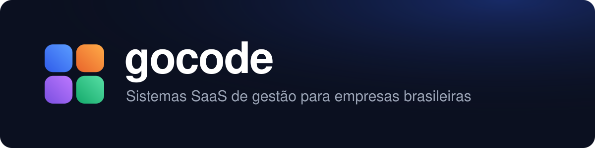

  

  
  
  

## Sobre a GoCode

A **GoCode Systems** cria sistemas de gestão na nuvem para empresas brasileiras. Em vez de um sistema enorme, com tudo para todos,
cada sistema GoCode é feito para um tipo de negócio e já vem com o que aquele ramo usa no dia a dia.

Todos funcionam no navegador e no celular, atendem várias empresas com os dados de cada uma separados, e podem ser revendidos
por parceiros. Também desenvolvemos **sistemas sob medida**.

## Sistemas

### Gestão: organizar a empresa por dentro

| | Sistema | Para quem |
|:-:|---|---|
|  | [**GoCode ERP**](https://erp.gocodesystems.com.br): vendas, estoque, financeiro e equipe | Comércios, prestadores de serviço e indústrias |
|  | [**GoCode Encomenda**](https://encomenda.gocodesystems.com.br): orçamento, produção e entrega | Confeitarias, gráficas, marcenarias, ateliês e obras |
|  | [**GoCode Escritório**](https://escritorio.gocodesystems.com.br): carteira, prazos e honorários | Contabilidade, advocacia, consultoria, seguros e imobiliárias |

### Serviços: atender, agendar e executar

| | Sistema | Para quem |
|:-:|---|---|
|  | [**GoCode Agenda**](https://agenda.gocodesystems.com.br): agendamento online e comanda | Salões, barbearias, estética, estúdios, academias e pet shops |
|  | [**GoCode Campo**](https://campo.gocodesystems.com.br): ordem de serviço e técnico no celular | Manutenção, instalação, climatização e assistência técnica |
|  | [**GoCode Projetos**](https://projetos.gocodesystems.com.br): kanban, horas e cobrança | Software houses, agências e times de tecnologia |

### Financeiro: receber e cobrar

| | Sistema | Para quem |
|:-:|---|---|
|  | [**GoCode Adquirente**](https://adquirente.gocodesystems.com.br): carteira, TPV, metas e rotas | Credenciadoras e equipes comerciais de maquininhas |
|  | [**GoCode Recorrente**](https://recorrente.gocodesystems.com.br): planos e cobrança mensal | Escolas, cursos, clubes, associações e serviços mensais |

### Vendas: encontrar clientes e vender

| | Sistema | Para quem |
|:-:|---|---|
|  | [**GoCode CRM**](https://crm.gocodesystems.com.br): prospecção e funil de vendas | Equipes de vendas B2B, representantes e consultores |
|  | [**GoCode Revenda**](https://revenda.gocodesystems.com.br): revendedoras, pedidos e acerto | Cosméticos, moda, semijoias e venda por catálogo |
|  | [**GoCode Rede**](https://rede.gocodesystems.com.br): rede, bônus e qualificação | Empresas de venda direta com rede de distribuidores |

### Outras marcas

| | Sistema | Para quem |
|:-:|---|---|
|  | [**WorkSy RH**](https://worksyrh.com.br): vagas e RH completo | Empresas que contratam e cuidam da própria equipe |
|  | [**Quinta do Conhecimento**](https://quintadoconhecimento.com.br): cursos, provas e certificados | Empresas que treinam a equipe |

## Como construímos

- **Cada empresa no seu espaço**: os dados de uma empresa nunca aparecem para outra; o próprio banco de dados garante isso.
- **Segurança**: https em tudo, dados sensíveis criptografados, auditoria de quem fez o quê e cuidado com a LGPD.
- **Cópias de segurança todo dia**, com teste automático de que a cópia volta.
- **Revenda por parceiros**: portal próprio para quem indica e revende os sistemas.

  
  
  
  
  

## Fale com a gente

- Site: [gocodesystems.com.br](https://gocodesystems.com.br)
- WhatsApp: [(85) 92007-4337](https://wa.me/5585920074337)
- Sistema sob medida: [gocodesystems.com.br/sob-medida](https://gocodesystems.com.br/sob-medida)

Gocode Ltda · CNPJ 68.360.302/0001-04
